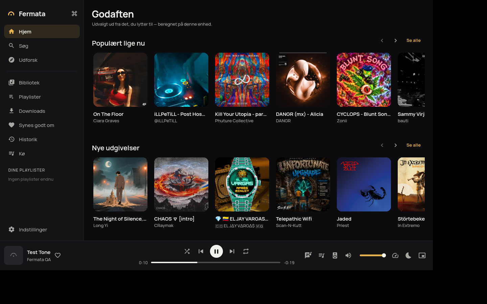

# Fermata

A calm, premium music player for **Windows, Linux and Android** — your own
files first, plus the services you already use, with reliable background
playback everywhere.

## Download

Get the latest installers from the **[Releases page](../../releases)**:

| Platform | File | Install |
|---|---|---|
| Windows 10/11 (x64) | `setup.exe` | Run it (per-user install, no admin needed). |
| Linux (x64) | `setup.sh` | `chmod +x setup.sh && ./setup.sh` (per-user, no root). |
| Android 7+ | `app.apk` | Open it on the phone and allow installing from this source. |

Details, uninstalling and troubleshooting: [docs/INSTALL.md](docs/INSTALL.md).

## Highlights

- **Background playback**: closes to the system tray on Windows/Linux (tray
  controls, MPRIS / Windows media overlay, media keys, global hotkeys); a
  foreground media service with lock-screen and Bluetooth controls on Android.
- **Sources**: local files, Audius and Deezer previews work with no setup.
  SoundCloud, Spotify (import), YouTube (import) and Jamendo work once
  developer credentials are configured — see [docs/PROVIDERS.md](docs/PROVIDERS.md)
  and [docs/CREDENTIALS.md](docs/CREDENTIALS.md).
- **Playlist migration**: import playlists and find the same recordings on
  your other sources with ISRC + fuzzy matching that never swaps a studio
  track for a remix or live version ([docs/MATCHING.md](docs/MATCHING.md)).
- **Offline**: downloads only where the provider allows it, with integrity
  checks, storage limits and Wi-Fi-only mode.
- **Design**: dark-first minimal UI, optional Liquid-Glass-style mode (off by
  default), performance / battery / data-saver modes, English and Danish.
- **Privacy**: local-first, no account needed, no analytics or tracking.

Provider terms shape what Fermata does (e.g. SoundCloud plays in its own queue
and is never downloaded): [docs/COMPLIANCE.md](docs/COMPLIANCE.md).

## Building

See [docs/BUILDING.md](docs/BUILDING.md). Architecture: [docs/ARCHITECTURE.md](docs/ARCHITECTURE.md).
Releases are built by GitHub Actions when a `v*` tag is pushed ([docs/RELEASING.md](docs/RELEASING.md)).
